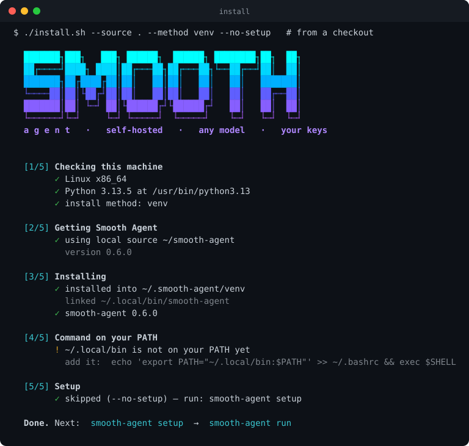
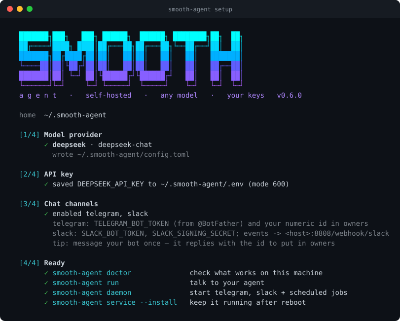
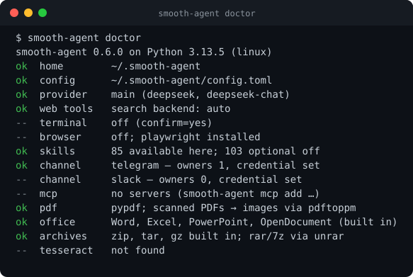

<p align="center">
  
</p>

<p align="center">
  <a href="https://github.com/smooth-family/smooth-agent/actions/workflows/ci.yml"></a>
  
  
  
  
  
</p>

<p align="center">
  A self-hosted AI agent that runs on your own machine, with your own keys, on any LLM you choose —<br>
  and that you can talk to from Telegram, WhatsApp, Slack, Matrix, LINE and more.
</p>

---

## Install

**One line** (Linux / macOS, Python 3.9+):

```bash
curl -fsSL https://raw.githubusercontent.com/smooth-family/smooth-agent/main/install.sh | bash
```

It checks your machine, installs with `pipx` (or a private virtualenv in
`~/.smooth-agent/venv`), puts `smooth-agent` on your PATH and starts the setup
wizard. Nothing is installed system-wide. Options: `--browser` (adds browser
automation), `--method pipx|venv`, `--ref <tag>`, `--no-setup`.


<p align="center"></p>

<details>
<summary><b>Other ways to install</b> — pipx, Docker, from source</summary>

**pipx**

```bash
pipx install git+https://github.com/smooth-family/smooth-agent
smooth-agent setup
```

**Docker** (everything the agent keeps lives in `./data`)

```bash
git clone https://github.com/smooth-family/smooth-agent && cd smooth-agent
docker compose run --rm smooth-agent setup   # provider, key, channels
docker compose up -d                         # channels + scheduled jobs, restarts on reboot
docker compose logs -f
```

Build with Chromium for the browser tools: set `BROWSER: "1"` in
`docker-compose.yml`. The container runs the agent as an unprivileged user.

**From source**

```bash
git clone https://github.com/smooth-family/smooth-agent && cd smooth-agent
pip install -e .                       # core: standard library + pypdf
pip install -e ".[browser]"            # + browser automation
python -m playwright install chromium  # (once, for the browser)
```

</details>

## First run

```bash
smooth-agent setup      # provider + model, your key, chat channels
smooth-agent doctor     # what works on this machine (--ping tests the model)
smooth-agent run        # talk to it in the terminal
smooth-agent daemon     # chat channels + scheduled jobs
```

<p align="center">
  
</p>

Everything lives in `~/.smooth-agent/` (override with `SMOOTH_AGENT_HOME`):
`config.toml` (providers and settings), `.env` (keys, mode 600), `skills/`,
`mcp.json`, and `smooth.db` (memory, sessions, jobs). Every option is in
[`smooth_agent/data/config.example.toml`](smooth_agent/data/config.example.toml).

## Why

- **Single-tenant, self-hosted.** One person, one box, your keys. No SaaS in the
  middle.
- **Any LLM.** OpenAI, Anthropic, DeepSeek, GLM (Zhipu), Groq, OpenRouter, Kimi,
  a local model, Smooth Router / 9router, or any OpenAI-compatible or
  Anthropic-native endpoint — with automatic fallback between them.
- **Talk to it from anywhere.** Telegram, WhatsApp, Slack, Matrix, LINE,
  WeChat and Discord. Each chat keeps its own conversation across restarts,
  only you (the owner) get answers, and risky actions arrive as ✅ / ❌ buttons.
- **Real tools.** Files (read, write, patch, search), web (search, read pages,
  APIs), a real browser, vision, image generation, text-to-speech, shell and
  Python with background processes, parallel sub-agents, and any MCP server.
- **Remembers.** Long-term memory of you and your work (recalled automatically
  each message), every conversation saved and searchable, resumable sessions,
  and long chats summarised instead of cut off.
- **Works while you sleep.** Scheduled jobs (`daily 07:00`, `every 2h`, cron)
  that survive restarts and retry, deliver their result to your chat, plus cheap
  script watchers that only wake the model when something changed.
- **~200 skills.** Tested playbooks for coding agents, GitHub, documents, media,
  research, finance, productivity, smart home and more. The agent reads a skill
  when a task matches it, and writes or improves its own skills as it learns
  your work.
- **Safe by default.** File tools are confined to one workspace folder (or the whole machine, with approvals, if you choose); shell and
  code run only when you switch them on, ask before each command, and never see
  your API keys; keys are redacted from everything printed.
- **Yours to modify.** MIT licensed. The core needs only the Python standard library and pypdf.

## Chat channels

| Channel | Direction | How it connects | What you need |
|---|---|---|---|
| **Telegram** | two-way, approval buttons | long-polling (no open port) | bot token from @BotFather |
| **WhatsApp** | two-way | Meta Cloud API webhook | token, phone-number id, verify token |
| **Slack** | two-way | Events API webhook (signed) | bot token, signing secret |
| **Matrix** | two-way | `/sync` long-polling (no open port), any homeserver | bot access token |
| **LINE** | two-way | Messaging API webhook (signed) | channel access token + secret |
| **WeChat Work** | delivery | group robot webhook | robot URL |
| **Discord** | delivery | channel webhook | webhook URL |

Pick them in `smooth-agent setup` (or `smooth-agent setup --channels telegram,slack`),
then run `smooth-agent daemon`. Keys go in `~/.smooth-agent/.env`; the config only
names the variable:

```toml
[channels]
enabled = ["telegram"]

[channels.telegram]
token_env = "TELEGRAM_BOT_TOKEN"
owners = ["123456789"]     # message the bot once — it replies with your id
auto_approve = false       # true = run your tool calls without the button tap
```

- **Owner only.** Anyone not in `owners` gets a short "this agent is private"
  reply with their id, and nothing else.
- **Approvals.** When the agent wants to run a command, you get the command
  with ✅ Allow / ❌ Deny buttons (Telegram); unanswered requests are denied.
- **One conversation per chat**, saved in `smooth.db`, resumed after a restart.
- **One message at a time.** Turns are handled in order, so your model provider
  never sees a burst of parallel requests.
- **Proactive messages.** The agent can reach you with the `send_message` tool,
  and scheduled jobs deliver their results:
  `smooth-agent cron add news "daily 07:00" "Top 5 tech stories" --deliver telegram`.
- Webhook channels (WhatsApp, Slack, LINE) listen on port `8808`
  (`/webhook/<channel>`); put it behind your HTTPS reverse proxy. Telegram and
  Matrix need no open port.

Test a channel without the daemon: `smooth-agent channels test telegram "hello"`.

**In the chat:** `/new` starts a fresh conversation (the old one stays saved and
searchable), `/status` shows the model, session and memory, `/model` switches
the model for that chat, `/stop` ends what the agent is doing, `/help`. While it
works you see one live message with its steps, shell-style — `$ git pull`,
`read app.py`, `write app.py`, `search …`, `open https://…` — which disappears
when the answer arrives.

**Send it files.** Photos, PDFs, Word, Excel, PowerPoint, OpenDocument, zip,
rar, 7z, tar — on Telegram just send them (an album counts as one message, a
caption is the request). They land in `workspace/inbox/<date>/` and the agent
reads them: `read_file` turns documents into text (spreadsheets per sheet,
tab-separated; a scanned PDF becomes page images for the vision model), photos go
to the vision model, and `extract_archive` unpacks archives safely (no paths
outside the folder, no links, size limits; it asks for the password of a
protected archive). Old binary `.doc`/`.xls` need LibreOffice; RAR and 7z need
`unrar`, `unar` or 7-Zip on the machine (the Docker image has them) —
`smooth-agent doctor` shows what this machine can read.

**Get files back.** Ask for a report or a sheet and it makes a real `.docx`
(headings, tables, lists from Markdown) or `.xlsx` (several sheets, bold frozen
header, numbers as numbers while phone numbers and IDs keep their leading zeros)
with `create_document`, and sends it with `send_file` — images arrive as photos,
`.ogg` as voice notes, everything else as a document (up to 50 MB).

**Talk to it.** Voice notes are transcribed and answered like typed messages
(`[stt]`: OpenAI, Groq, a local whisper server or a gateway); with
`voice_replies = "auto"` a voice note gets the answer as text *and* as a voice note
(`[tts]`, ffmpeg). Code and links are left out of the spoken version.

## Persona files

`~/.smooth-agent/workspace/` holds six Markdown files that are part of the
agent's instructions on every message: `SOUL.md` (character and tone),
`IDENTITY.md`, `USER.md` (about you), `AGENTS.md` (how it works),
`TOOLS.md` and `MEMORY.md`. They start empty and cost nothing until you — or the
agent, when you ask it — write in them.

## File access

By default the file tools stay inside the workspace. `[tools] files = "full"`
lets them reach the whole machine (Linux, macOS, Windows): reading anywhere is
free, while writing outside the workspace and reading files that hold secrets
(`.env`, `~/.ssh`, `*.pem`, …) ask you first — on Telegram as ✅ / ❌ buttons.
`[tools] terminal = true` adds shell commands, each one approved the same way.

## Keep it running

```bash
smooth-agent service --install   # systemd user unit on Linux, launchd agent on macOS
systemctl --user enable --now smooth-agent
loginctl enable-linger $USER     # servers: keep running after you log out
```

<p align="center">
  
</p>

## Use

```bash
smooth-agent run                    # interactive agent (/reset, /exit)
smooth-agent run --resume           # continue the last session
smooth-agent ask "find the 3 newest Python releases and save them to releases.md"
smooth-agent ask --terminal "run the tests in ./app and fix what fails"   # asks before each command
smooth-agent chat "hello"           # plain chat, no tools

smooth-agent channels list | test <name> [chat_id] "<message>"
smooth-agent daemon [--no-channels] # chat channels + scheduled jobs
smooth-agent service [--install]    # background service (systemd / launchd)

smooth-agent skills list | search <words> | install <name|git-url|path> | remove <name>
smooth-agent mcp add github --env 'GITHUB_PERSONAL_ACCESS_TOKEN=${GITHUB_TOKEN}' -- npx -y @modelcontextprotocol/server-github
smooth-agent mcp add docs --url https://example.com/mcp
smooth-agent mcp list | tools <name> | remove <name>
smooth-agent providers

smooth-agent memory list | add "…" --kind preference | search <words> | remove <id>
smooth-agent sessions list | show <id> | search <words>
smooth-agent cron add morning "daily 07:00" "Summarise the top tech news for me" --deliver telegram
smooth-agent cron add hn "*/15 * * * *" --script "python3 watch_rss.py --name hn --url https://news.ycombinator.com/rss"
smooth-agent cron list | run <name> | pause <name> | remove <name>
```

## Tools

| Tool | What it does | Default |
|---|---|---|
| `read_file`, `write_file`, `patch`, `list_dir`, `search_files` | files (documents, spreadsheets and PDFs come back as text) | on |
| `extract_archive` | unpack zip, rar, 7z, tar, gz safely | on |
| `create_document` | make .docx / .xlsx / .csv files | on |
| `send_file` | send a file to you in the chat | when a channel runs |
| `transcribe_audio` | speech in audio or video files to text | when `[stt]` is set |
| `web_search`, `web_extract`, `http_get` | search (Tavily / Brave / SearXNG / DuckDuckGo), readable pages, raw APIs | on |
| `todo` | task list for multi-step work | on |
| `delegate_task` | up to 6 sub-agents in parallel | on |
| `skills_list`, `skill_view`, `skill_manage` | find, read and write skills | on |
| `memory` | long-term memory: add / replace / remove / search / pin | on |
| `session_search` | search past conversations | on |
| `cronjob` | schedule agent runs and script watchers | on (scripts need `terminal`) |
| `clarify` | ask you a question with choices | on |
| `send_message` | message you on a chat channel | when a channel runs |
| `vision_analyze` | understand images (URL, file, screenshot) | on |
| `terminal`, `execute_code`, `process` | shell / Python on your machine, background processes with exit notices | `[tools] terminal = true`, asks first |
| `browser_navigate`, `_click`, `_type`, `_press`, `_scroll`, `_back`, `_snapshot`, `_console`, `_get_images`, `_screenshot`, `_vision` | a real Chromium browser with your saved logins | `[browser] enabled = true` |
| `image_generate` | create images into the workspace | when `[image]` is set |
| `text_to_speech` | MP3 from text | when `[tts]` is set |
| `mcp_<server>_<tool>` | every tool of every MCP server you add | per server |

## Development

```bash
python -m venv .venv && .venv/bin/pip install -e ".[dev]"
.venv/bin/python -m unittest discover -s tests   # 162 tests, Python 3.9 – 3.13
.venv/bin/python scripts/term_svg.py             # regenerate the README images from real output
```

See [ROADMAP.md](ROADMAP.md) for what is next.

## License

MIT © Smooth. Includes MIT-licensed third-party material; see
[THIRD_PARTY_NOTICES.md](THIRD_PARTY_NOTICES.md).
